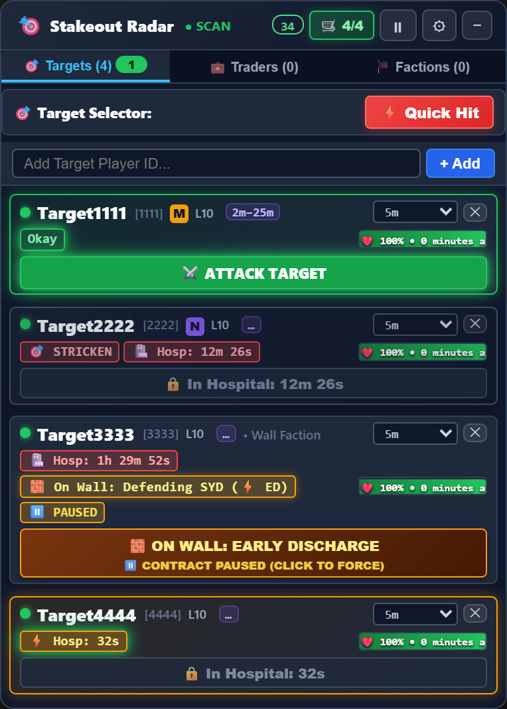
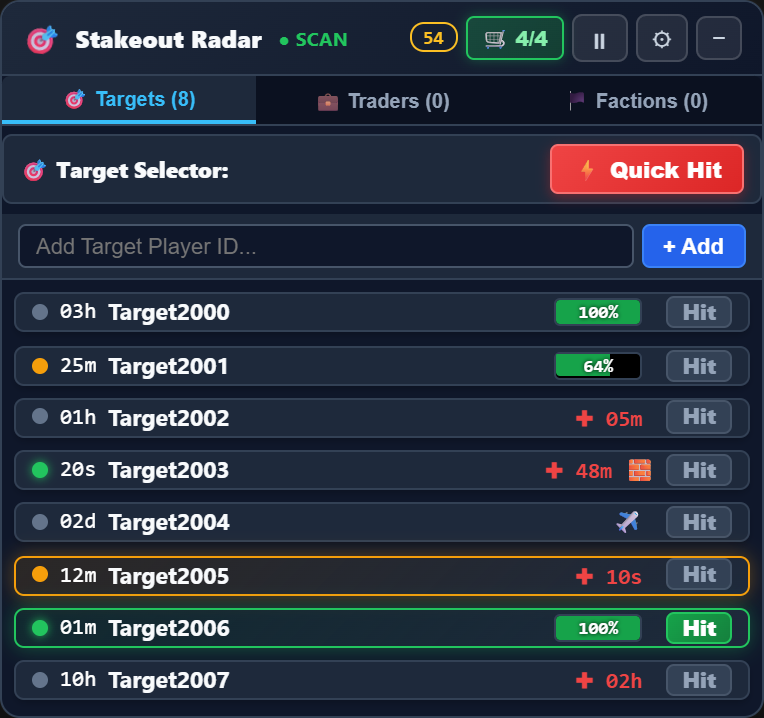
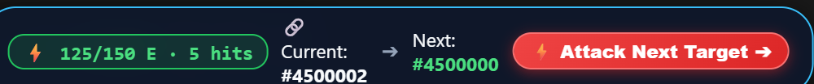
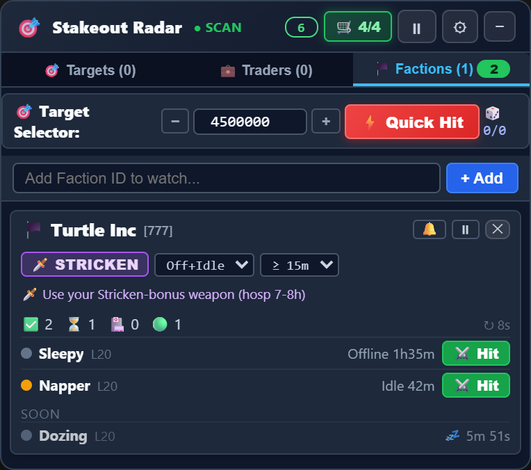
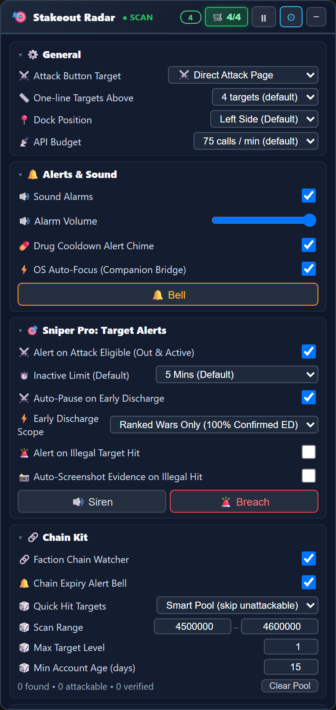
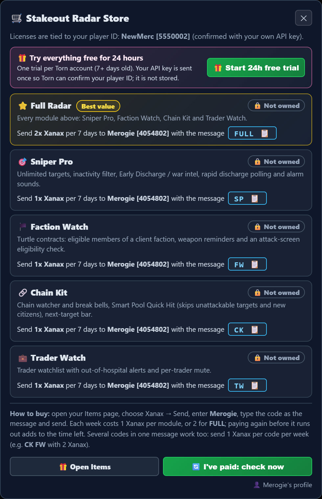

# 🎯 Mercenary Stakeout Radar

A stakeout radar for Torn City mercenaries: it watches your targets and tells you the moment they can be hit. It can also track hospital timers, walls and Early Discharge, faction turtle contracts, chain targets and traders.

**[⬇️ Install for Tampermonkey / Violentmonkey](https://raw.githubusercontent.com/MerogieMagic/stakeout-radar-releases/main/torn_mercenary_stakeout.user.js)** · 🎁 **24-hour free trial** of every module, inside the radar · Made by [Merogie [4054802]](https://www.torn.com/profiles.php?XID=4054802)

The install link gives you the free radar. Paid modules and the free trial run in your own [personal copy](#-your-personal-copy), one click away in the radar's Store.

## Built for how you merc

### 🎯 Ad-hoc merc contracts: the target watcher (Sniper Pro)

Add the contract target and get on with your day. The radar rings only when the target meets **every condition of the contract**:

- **Okay**: out of hospital and not in jail, abroad or flying.
- **Active the way the contract asks**: online now, or last action within 2, 5, 10, 15, 30 or 60 minutes (set per target), or any activity.
- **No Early Discharge**: if they're in a ranked war or on a territory wall (attacking or defending), the contract pauses itself, so you don't hit someone who can be pulled out of hospital. Click to force it if you choose to.

Also for contracts:
- **Stricken contracts:** right-click a target to tag it 🎯 Stricken. It's alerted like any other target, and every alert adds "🗡️ Use your Stricken weapon!". Its card and attack button turn purple as a reminder. Right-click again to untag.
- Hospital countdown, with polling every second in the last minute, so you're on the attack page the moment they're out.
- Flight landings: an alert when they land and are hittable.
- Illegal-hit evidence (turn it on in Options): if someone else hospitalizes your target, you get an evidence card with a screenshot.
- More than 4 targets fold into one-line rows. Each row shows online status, time since last action, name, then an HP bar when they're out or a red ✚ with their hospital time, 🧱 when they're on a wall, ✈️ when flying, and **Hit**, which turns green when they can be hit. Click a row for the full card.

### 🔗 Saving chains and farming Halloween treats: Chain Kit

When the chain is about to drop, or you just want to burn your energy, you need a hittable target **now**, not a search through the people page.

- **Quick Hit** opens an attack on a target from your **Smart Pool**: low-level accounts checked to be out of hospital, not in jail, not abroad, not federal and not under new-citizen protection. The pool is matched to your own account: newer players get the newest, weakest accounts; veterans get a wider pool reaching a little further up. Each merc gets their own slice, so you don't collide on the same targets. Nothing to set up.
- On the attack screen, the **Attack Next Target** bar takes you to the next pool target in one click, and shows your energy left ("125/150 E · 5 hits").
- **Chain watcher:** chain timer bells before the chain breaks.
- Ideal for Halloween: dump your energy into fast, easy hits to farm treats.

### 🏴 Turtling a faction, before or during a war: Faction Watch

Add the client faction and see at a glance which members you're allowed to hit.

- Members are sorted into **eligible**, **soon**, **in hospital** and **active**, using the contract's rule: offline, idle or both for at least X minutes, or **online right now** when the job is to hospitalize the onliners.
- Each merc sees the eligible members in a different order, so you spread out instead of all hitting the same member.
- The contract shows a **Stricken** or **Standard** weapon reminder.
- On the attack screen a banner confirms whether this member is eligible, before you swing.
- A chime when someone becomes eligible.

### 💼 Hospitalization services: Trader Watch

Traders who regularly ask to be hospitalized for safe-keeping can be watched like targets. You're alerted the moment one is **out of hospital or has landed, and online or idle**, so you can offer your service or hit them straight away, before someone else mugs them. Mute any trader on their own.

### Free for everyone

- Watch 1 target: hospital timer, and a desktop notification when they're out (alarm sounds come with Sniper Pro).
- Energy left on the attack screen.
- A small counter in the header shows your API calls per minute.
- Works with several Torn tabs open: only one tab polls the API and only one tab rings, so your API usage doesn't multiply.

### Modules at a glance

| Module | Code | For |
|---|---|---|
| 🎯 **Sniper Pro** | `SP` | Ad-hoc contracts: unlimited targets, contract-aware alarm, Early Discharge and wall detection, Stricken tags, illegal-hit evidence |
| 🔗 **Chain Kit** | `CK` | Chains and energy dumps: Smart Pool, Quick Hit, Attack Next Target bar, chain bells |
| 🏴 **Faction Watch** | `FW` | Turtling: eligible members, weapon reminder, attack-screen check |
| 💼 **Trader Watch** | `TW` | Traders who need hospitalizing: out-and-online alerts |
| ⭐ **Full Radar** | `FULL` | All four modules |

## Pricing

| | Price |
|---|---|
| One module | **1 Xanax per 7 days** |
| Full Radar (`FULL`) | **2 Xanax per 7 days** 🎃 **Year-end promo: 1 Xanax per 7 days** for gifts sent until 31 Dec 2026 (Torn time). Promo time can run up to 31 Dec 2027. |
| Free trial | **24 hours of everything**, once per Torn account (accounts 7+ days old) |

**How to buy:** on your Items page, send Xanax to **Merogie [4054802]** with the module code as the message, for example `CK`.
- Paying again before your time runs out adds to it.
- For several modules in one gift, put all the codes in the message and send 1 Xanax per code: `CK FW` with 2 Xanax gives a week of each.
- Payments are picked up automatically, usually within 2 minutes. The radar's **🛒 Store** shows your days left, and its **I've paid** button unlocks without a page reload.
- If the message doesn't match a code exactly, the gift is still applied: first to the first code it can pay for, otherwise to the module whose code starts with the first matching letter (C → Chain Kit, F → Faction Watch, S → Sniper Pro, T → Trader Watch).

## ⭐ Your personal copy

The paid modules are not in the public download. Once you have paid or started the free trial, the Store offers **⭐ Get my personal copy**: a copy of the radar made for your Torn account.

- **Install it once.** It replaces the free copy and keeps your targets and settings. It updates itself from then on.
- **It runs only for you.** On another player's account it switches itself off and offers them the free radar instead.
- **Changed your Torn name?** The radar asks you to get a copy with your new name: one click, then Install. Your time and settings are kept.
- **When your time runs out,** the paid modules lock straight away, and your copy turns into the free radar at the next release. Pay again and your copy offers the update that brings the modules back.
- **Keep it to yourself.** Every copy can be traced to the account it was made for, and a link that gets shared can be cancelled.

## Setup

1. Install [Tampermonkey](https://www.tampermonkey.net/) or [Violentmonkey](https://violentmonkey.github.io/), then click **[Install](https://raw.githubusercontent.com/MerogieMagic/stakeout-radar-releases/main/torn_mercenary_stakeout.user.js)**.
2. Open Torn. The radar asks for an API key. Click **✨ Generate key**: Torn opens its key page with only the access the radar needs already ticked (a Custom key). Create it, then paste it in.
3. To try every module, open **🛒 Store** and click **🎁 Start 24h free trial**. To buy, see [Pricing](#pricing).
4. Then, in the Store, click **⭐ Get my personal copy** (after a trial it's already there) and **⬇️ Install my copy**, choose Install / Reinstall in the tab that opens, and refresh Torn.

Updates install automatically. When a new version is out, the radar shows an **Update now** banner.

## Privacy and API terms

This follows the disclosure asked for by Torn's API terms of use.

| | |
|---|---|
| **Data storage** | Everything the radar fetches about your targets, factions and traders stays in your browser. The license server stores only: your player ID and player name, which modules you have and until when, a history of your payments (log ID, Xanax amount and message), and, if you used the free trial, when you started it. Your personal copy contains your player ID and name, so it runs only on your account. |
| **Data sharing** | None. Nothing is shared with or sold to anyone. |
| **Purpose of use** | Showing you, the key owner, when your own targets can be hit; and licensing the paid modules. |
| **Key storage and sharing** | Your key is stored only in your browser's userscript storage. It is used to call `api.torn.com` directly. It is sent to the license server only when you start the free trial or ask for your personal copy, so Torn can confirm your player ID and name; it is used for that single call and never stored or logged. |
| **Key access level** | A Custom key with: user `basic, profile, bars, cooldowns`, faction `basic`, torn `rankedwars, territorywars`. Use **✨ Generate key** to create exactly that. |

The seller's own server reads only the seller's item log (Custom key: user → log) to detect Xanax payments.

## Support

Message **[Merogie [4054802]](https://www.torn.com/profiles.php?XID=4054802)** in Torn. If a payment hasn't shown up after a few minutes, include the time you sent it and the message you used.

*This is a fan-made tool and is not affiliated with or endorsed by Torn.*
